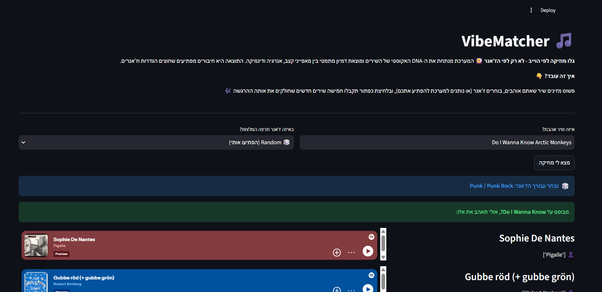

# 🎵 VibeMatcher

Find songs that *feel* like a song you love, even when they come from a completely different genre. Type a song, pick a genre, and VibeMatcher returns five tracks with a similar vibe, each with a short reason why it was chosen.

**Live app:** [vibematcheralgo.streamlit.app](https://vibematcheralgo.streamlit.app)



## How it works

Every song is described by 8 audio features from Spotify's dataset: tempo, energy, loudness, danceability, valence (dark → happy), acousticness, instrumentalness and speechiness. Two songs are "similar" when they are close together in that 8-dimensional space.

1. **Standardize every feature** (z-score). Tempo runs from 50 to 220 while energy runs from 0 to 1, so without this step tempo would drown out everything else. After standardizing, a weight of 2 really means "twice as important".
2. **Weight the features.** Tempo and energy count most, loudness next. Speechiness and danceability are kept low on purpose, because they work as hidden genre signals (rap scores high on both) and would trap results inside one genre.
3. **Weighted Euclidean distance** from the chosen song to every other song, computed in NumPy.
4. **Genre mode**, chosen by the user:
   * *Soft* (default): songs outside the target genre get a small distance penalty, so a strong vibe match from another genre can still win.
   * *Strict*: only songs from the target genre.
   * *Off*: vibe only.
5. **Explain the result.** Each recommendation shows its genre and a comparison with the original (tempo, energy, loudness, mood).

### About the genre labels

The dataset stores genres per *artist*, not per song, so labels are approximate. An artist's main genre is chosen by majority vote over their tags, which fixed cases like an R&B singer being labelled "Rap" because of a single hip-hop tag.

## Testing

* `tests/` holds a pytest suite with a small hand-made catalogue (so every expected answer can be checked by eye) and fake Last.fm responses (no network needed).
* GitHub Actions runs the tests on every push and pull request.
* `evaluate_vibes.py` is a scorecard of "golden pairs": songs a human hears as sharing a vibe across genres. It prints where the second song lands in the first one's results, so a weight change can be judged with numbers instead of by ear.

## In progress: Last.fm tags

`fetch_tags.py` is a one-time, resumable script that downloads Last.fm listener tags per *song* (falling back to the artist), cleaning titles like `Song - 2005 Remaster` or `Song (feat. X)` first. The goal is better per-song genres and a vocal-intensity signal (calm vs. shouted) that Spotify's numbers cannot provide. The app does not use the tags yet.

`python fetch_tags.py --diagnose 100` shows what Last.fm answers for a random sample of songs, without saving anything.

## Run locally

```bash
git clone https://github.com/iiiadam3/VibeMatcher.git
cd VibeMatcher
python -m venv .venv
source .venv/bin/activate        # Windows: .venv\Scripts\activate
pip install -r requirements.txt
streamlit run SpotifyVibeMatcher.py
```

Run the tests with `pip install -r requirements-dev.txt` and then `pytest`.

## Data

Kaggle's Spotify dataset: about 586,000 tracks released up to 2021 (about 575,000 remain after dropping rows with missing genres or a broken tempo of 0), plus their artists, stored as `tracks.zip` and `artists.zip`. Spotify closed its audio-features API to new apps in late 2024, so the project uses this static dataset instead of live data.

## Tech stack

Python · Pandas · NumPy · Streamlit · pytest · GitHub Actions · Last.fm API
